<picture><source media="(prefers-color-scheme: dark)" srcset="assets/hero-dark.svg"><source media="(prefers-color-scheme: light)" srcset="assets/hero-light.svg"></picture>

[Explore the work](#selected-work) · [Inside the projects](#inside-the-projects) · [All repositories](https://github.com/STEVVVU?tab=repositories)

I build systems software, developer tools, and graphics. I'm interested in what happens inside: the write that survives a crash, the worker that recovers, and the frame that reaches the screen.

### Selected work

Select a project to inspect the code.

<a href="https://github.com/STEVVVU/stratadb"><picture><source media="(prefers-color-scheme: dark)" srcset="assets/stratadb-dark.svg"><source media="(prefers-color-scheme: light)" srcset="assets/stratadb-light.svg"></picture></a> <a href="https://github.com/STEVVVU/edgeproxy"><picture><source media="(prefers-color-scheme: dark)" srcset="assets/edgeproxy-dark.svg"><source media="(prefers-color-scheme: light)" srcset="assets/edgeproxy-light.svg"></picture></a>

<a href="https://github.com/STEVVVU/durableflow"><picture><source media="(prefers-color-scheme: dark)" srcset="assets/durableflow-dark.svg"><source media="(prefers-color-scheme: light)" srcset="assets/durableflow-light.svg"></picture></a> <a href="https://github.com/STEVVVU/warpforge-mlir"><picture><source media="(prefers-color-scheme: dark)" srcset="assets/warpforge-mlir-dark.svg"><source media="(prefers-color-scheme: light)" srcset="assets/warpforge-mlir-light.svg"></picture></a>

<a href="https://github.com/STEVVVU/chainindex"><picture><source media="(prefers-color-scheme: dark)" srcset="assets/chainindex-dark.svg"><source media="(prefers-color-scheme: light)" srcset="assets/chainindex-light.svg"></picture></a> <a href="https://github.com/STEVVVU/lumenforge-webgl"><picture><source media="(prefers-color-scheme: dark)" srcset="assets/lumenforge-webgl-dark.svg"><source media="(prefers-color-scheme: light)" srcset="assets/lumenforge-webgl-light.svg"></picture></a>

### Inside the projects

Read the architecture and failure models

- [StrataDB storage architecture](https://github.com/STEVVVU/stratadb/blob/main/docs/architecture.md) and [failure model](https://github.com/STEVVVU/stratadb/blob/main/docs/failure-model.md)
- [EdgeProxy protocol and failure model](https://github.com/STEVVVU/edgeproxy/blob/main/docs/protocol-and-failure-model.md)
- [DurableFlow delivery and recovery guarantees](https://github.com/STEVVVU/durableflow/blob/main/docs/failure-model.md)
- [LumenForge rendering architecture](https://github.com/STEVVVU/lumenforge-webgl/blob/main/docs/ARCHITECTURE.md)

More experiments in languages, compute, and tooling

- [EmberLang](https://github.com/STEVVVU/emberlang-vm): a Rust compiler and bytecode VM.
- [KernelForge](https://github.com/STEVVVU/kernelforge-gpu): CUDA kernel fusion and correctness checks.
- [Traceframe](https://github.com/STEVVVU/traceframe): a Python execution visualizer.
- [SRE Observatory](https://github.com/STEVVVU/sre-observatory): an infrastructure and observability reference.
- [Microbook](https://github.com/STEVVVU/microbook-quant): market-data ingestion and order-book replay.

See a frame from the LumenForge renderer

Original SVG artwork, generated from [source](scripts/render_profile.py). The header settles after 4.6 seconds and respects reduced-motion preferences.
