<h3><code>stevvvu@github ~ $ ./contributions.sh</code></h3>

  
<h3><code>stevvvu@github ~ $ whoami</code></h3>
<table>
<tr>
<td valign="top"></td>
<td valign="top"></td>
</tr>
</table>

[About me](#about-me) · [Selected projects](#selected-projects) · [Tools and languages](#tools-and-languages) · [Engineering notes](#engineering-notes)

### About me

I'm Steven. I build systems software, developer tools, and graphics projects. My repositories explore how data survives a crash, how workers recover after a failure, how compilers transform a program, and how a renderer turns a scene into pixels.

I like implementations that make their behavior inspectable through tests, event histories, diagnostics, and documented limits. Below are a few places to start.

### Selected projects

#### [LumenForge](https://github.com/STEVVVU/lumenforge-webgl) · WebGL2 renderer and glTF inspector

A material inspector with deferred PBR lighting, shadows, GPU object picking, and frame diagnostics. The scene below is the project's deterministic material-grid workload. You can inspect the scene hierarchy, change materials, and switch between rendering buffers.

`TypeScript` `React` `WebGL2` `glTF`

[Explore the renderer](https://github.com/STEVVVU/lumenforge-webgl) · [Run locally](https://github.com/STEVVVU/lumenforge-webgl#setup) · [Browser verification](https://github.com/STEVVVU/lumenforge-webgl/blob/main/artifacts/verification.md)

#### [StrataDB](https://github.com/STEVVVU/stratadb) · Embedded storage in Rust

A key-value engine with a checksummed write-ahead log, atomic batches, snapshots, segment rotation, and compaction. Recovery repairs an incomplete active tail and rejects corruption in sealed segments. The repository includes fault-injection tests and offline inspection tools.

`Rust` `Storage` `Crash recovery`

[Explore the engine](https://github.com/STEVVVU/stratadb) · [Recovery tests](https://github.com/STEVVVU/stratadb/tree/main/tests) · [On-disk format](https://github.com/STEVVVU/stratadb/blob/main/docs/on-disk-format.md)

#### [EdgeProxy](https://github.com/STEVVVU/edgeproxy) · Async HTTP reverse proxy

An HTTP/1.1 proxy with strict request framing, bounded concurrency, upstream health checks, and circuit breakers. Retry decisions depend on how far a request has progressed, so a failure after sending gets different treatment from a failed connection.

`Rust` `Tokio` `HTTP` `Prometheus`

[Explore the proxy](https://github.com/STEVVVU/edgeproxy) · [Integration tests](https://github.com/STEVVVU/edgeproxy/tree/main/tests) · [Protocol and retry model](https://github.com/STEVVVU/edgeproxy/blob/main/docs/protocol-and-failure-model.md)

#### [DurableFlow](https://github.com/STEVVVU/durableflow) · Durable job orchestration

A Python job queue with SQLite persistence, expiring leases, stale-worker fencing, retries, cancellation, and dead-letter redrive. A deterministic chaos harness exercises worker loss and recovery. Delivery is at least once, with explicit treatment of external side effects.

`Python` `SQLite` `Workers` `Failure recovery`

[Explore the queue](https://github.com/STEVVVU/durableflow) · [Chaos harness](https://github.com/STEVVVU/durableflow/blob/main/durableflow/chaos.py) · [Delivery guarantees](https://github.com/STEVVVU/durableflow/blob/main/docs/failure-model.md)

#### More work in compilers and indexing

| Project | What to explore |
| --- | --- |
| [WarpForge](https://github.com/STEVVVU/warpforge-mlir) | An LLVM/MLIR optimizer with matmul epilogue fusion, tiling, vectorization, and progressive lowering. [Pass invariants](https://github.com/STEVVVU/warpforge-mlir/blob/main/docs/PASSES.md). |
| [ChainIndex](https://github.com/STEVVVU/chainindex) | An EVM event indexer with transactional checkpoints, resumable backfills, and common-ancestor rollback after a chain reorganization. [Architecture](https://github.com/STEVVVU/chainindex/blob/main/docs/ARCHITECTURE.md). |

### Tools and languages

These are the tools used in the projects above.

| Area | Tools |
| --- | --- |
| Storage and networking | Rust, Tokio, HTTP/1.1 |
| Job orchestration | Python, SQLite, Prometheus |
| Compilers | C++, LLVM, MLIR, CMake |
| Graphics and interfaces | TypeScript, React, WebGL2, glTF |
| Event indexing | TypeScript, ethers, Fastify, SQLite, Solidity |

### Engineering notes

Some of the most useful entry points are the design documents behind the code.

- [What survives a partial write?](https://github.com/STEVVVU/stratadb/blob/main/docs/failure-model.md) StrataDB's recovery rules and the distinction between process crashes and power loss.
- [When is an HTTP retry safe?](https://github.com/STEVVVU/edgeproxy/blob/main/docs/protocol-and-failure-model.md) EdgeProxy's retry matrix and protocol boundaries.
- [What happens when a worker disappears?](https://github.com/STEVVVU/durableflow/blob/main/docs/failure-model.md) DurableFlow's leases, stale owners, and delivery semantics.
- [How does a frame reach the screen?](https://github.com/STEVVVU/lumenforge-webgl/blob/main/docs/ARCHITECTURE.md) LumenForge's rendering passes, resource ownership, and failure behavior.

[Browse all public repositories](https://github.com/STEVVVU?tab=repositories&type=public)

---

Calendar snapshot: October 20, 2026. Terminal header and animation code copied from [navi3582/animated-github-profile](https://github.com/navi3582/animated-github-profile) under the [MIT license](./LICENSE). [Source and regeneration](./scripts/README.md).
