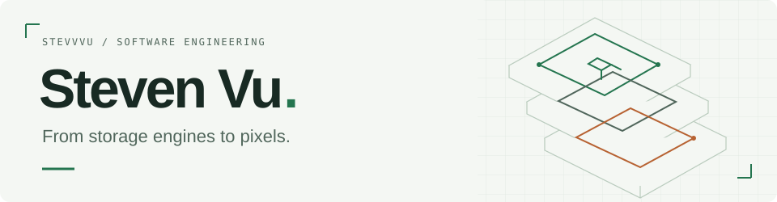

<picture>
  <source media="(prefers-color-scheme: dark)" srcset="assets/header-dark.svg">
  <source media="(prefers-color-scheme: light)" srcset="assets/header-light.svg">
  
</picture>

[Selected work](#selected-work) · [More to explore](#more-to-explore) · [All repositories](https://github.com/STEVVVU?tab=repositories)

I build systems software, developer tools, and graphics. I like projects where the interesting part is below the surface: how data survives a crash, how work recovers after a failure, or how a frame reaches the screen.

### Selected work

| Project | A closer look |
| :--- | :--- |
| [**StrataDB**](https://github.com/STEVVVU/stratadb) | A Rust storage engine with a checksummed write-ahead log, atomic batches, snapshots, and crash recovery. |
| [**EdgeProxy**](https://github.com/STEVVVU/edgeproxy) | An HTTP/1.1 reverse proxy in Rust. Bounded concurrency, health checks, circuit breakers, and phase-aware retries. |
| [**DurableFlow**](https://github.com/STEVVVU/durableflow) | A Python job queue with durable state, fenced worker leases, retry scheduling, and recovery tests. |
| [**WarpForge**](https://github.com/STEVVVU/warpforge-mlir) | An LLVM/MLIR optimizer for neural-network workloads, with graph fusion, tiling, vectorization, and progressive lowering. |
| [**ChainIndex**](https://github.com/STEVVVU/chainindex) | An EVM event indexer that handles chain reorganizations, paired with a Solidity escrow contract and deterministic tests. |
| [**LumenForge**](https://github.com/STEVVVU/lumenforge-webgl) | A WebGL2 renderer and glTF inspector with deferred PBR lighting, object picking, and frame diagnostics. |

### More to explore

- **Languages & compute** · [Rust compiler and bytecode VM](https://github.com/STEVVVU/emberlang-vm) · [CUDA kernel fusion](https://github.com/STEVVVU/kernelforge-gpu)
- **Tools & infrastructure** · [Python execution visualizer](https://github.com/STEVVVU/traceframe) · [SRE reference platform](https://github.com/STEVVVU/sre-observatory)

Rust · Python · TypeScript · C++ / CUDA · SQL
